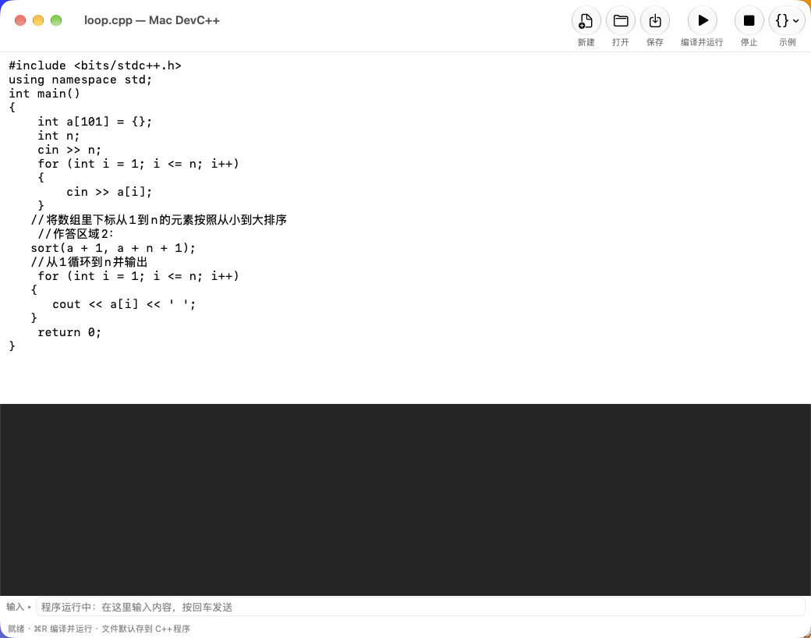

# Mac DevC++

在 macOS 上复刻 Dev-C++ 体验的轻量 C++ 编程环境，面向刚学 C++ 的学生（作业、OJ 练习）。
单个 Swift 文件实现，原生 arm64，无需安装任何 IDE。



## 为什么做这个

Dev-C++ 只有 Windows 版。孩子在 Windows 上写的 `.cpp`（常常是 GBK 编码、带 `#include <bits/stdc++.h>`）拿到 Mac 上既打不开也编译不过。Mac DevC++ 就是为了让这些代码在 Mac 上原样能跑。

## 功能

- **一键编译运行**：调用系统 `/usr/bin/clang++`（`-std=c++17 -Wall -Wextra`），无需 Xcode 工程
- **真终端运行**：程序跑在 pseudo-terminal 上，`cin` 交互、缓冲行为和控制台一致
- **兼容 Windows 代码**
  - 自动识别并转换 GBK / GB2312 源文件
  - 内置 `bits/stdc++.h` 转发头，`#include <bits/stdc++.h>` 直接可编译
- **编辑器**：自动缩进、括号配对、块缩进、行号
- **7 个入门示例**：Hello World、输入与计算、循环求和、冒泡排序、猜数字、结构体排序、竞赛风格数组求和
- **文件管理**：默认工作目录 `~/Documents/C++程序`

## 环境要求

- macOS 14 及以上，Apple Silicon
- Xcode Command Line Tools（提供 `clang++` 与 `swiftc`）：`xcode-select --install`

## 构建并安装

```bash
./build.sh
```

脚本会编译出 `Mac DevC++.app`，ad-hoc 签名，自测通过后安装到 `/Applications`。

## 自测

无界面跑通「编译 + pty + 标准输入」全链路：

```bash
dist/Mac\ DevC++.app/Contents/MacOS/CppDev --selftest
```

## 目录结构

```
Sources/main.swift                     全部实现（约 1200 行）
Resources/include/bits/stdc++.h        GCC 风格转发头
assets/                                应用图标
Info.plist                             Bundle 配置
build.sh                               构建 + 签名 + 自测 + 安装
```

## 许可

未指定许可证，默认作者所有。
